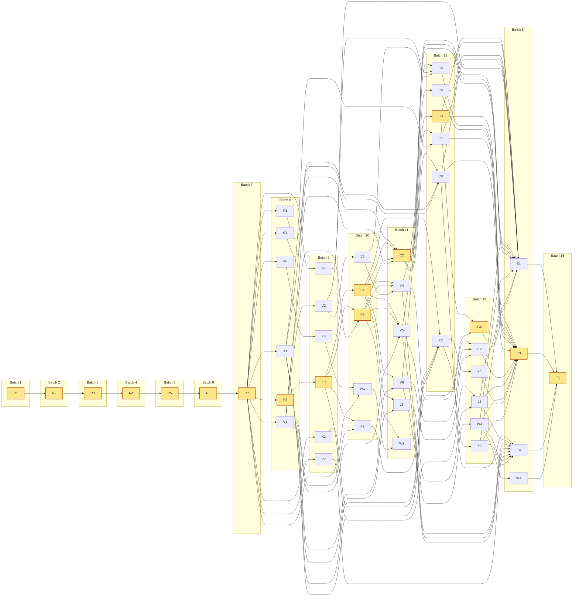

# Quark backend parity: orchestration map
Source: docs/plans/2026-10-08-rust-desktop-parity.md (47 unit cards) · spec docs/plans/2026-10-08-rust-desktop-parity-design.md · branch rust-desktop/parity · integration ff-only per approved unit, push at sprint gates, no merge/PR
`core/` means `crates/quark-core/`. Workers read their card from the plan by line range (`rg -n '^#### <ID> ·'`).
<!-- additive: core/src/http/mod.rs, core/src/runtime/mod.rs, core/src/runtime/cache/mod.rs, core/src/relation/mod.rs, core/src/relation/profile.rs, core/src/shared/mod.rs, core/src/shared/encode/mod.rs, core/src/features/mod.rs, core/src/features/charts/service.rs, core/src/features/exports/service.rs, tests/rust_pending.txt, tests/test_backend.py, core/Cargo.toml -->

## Numbers

- Units 47 (46 worker, 1 loop) · critical path 15 waves · batches 15 · sprints 8
- Run ≤9 agents: 6 workers + TMs (≤3 units each) + 1 spare · largest run 9
- Spawned 79 planned, 79–88 with extras · peak alive ≈11 (largest run + SM + Lead)
- Tokens ≈4.1M (Σ role peak × count, ±50%, same unit as the runtime's per-agent figure; billed input incl. cache reads ≈5–13×; recalibrate after batch 1 with --avg-agent-k)
- Context limit 100k (10.0% of 1000k window)
- Additive, shared by several units (rebase keeps both sides, lockfiles regenerated): `Cargo.toml`

## Units

| ID | Task | Files | Needs | Flags | Batch | Slack |
|---|---|---|---|---|---|---|
| **R1** | §7 R1 shared atoms | `core/src/shared/sql.rs` `core/src/shared/types.rs` `core/src/values.rs` | - |  | 1 | 0 |
| **R2** | §7 R2 relation molecules | `core/src/relation/request.rs` `core/src/relation/target.rs` `core/src/page.rs` | R1 |  | 2 | 0 |
| **R3** | §7 R3 runtime moves | `core/src/runtime/engine.rs` `core/src/runtime/dirs.rs` `core/src/cache/columnar.rs` | R2 |  | 3 | 0 |
| **R4** | §7 R4 catalog split | `core/src/state.rs` `core/src/runtime/catalog.rs` `core/src/runtime/engines.rs` | R3 |  | 4 | 0 |
| **R5** | §7 R5 projects and sources features | `core/src/features/projects/service.rs` `core/src/features/sources/service.rs` `core/src/features/sources/uploads.rs` | R4 |  | 5 | 0 |
| **R6** | §7 R6 pages feature and http layer | `core/src/features/pages/service.rs` `core/src/http/deps.rs` `src-tauri/src/lib.rs` | R5 |  | 6 | 0 |
| **R7** | §7 R7 architecture test, drop generation | `core/tests/architecture.rs` `core/src/runtime/engines.rs` `core/src/runtime/state.rs` | R6 |  | 7 | 0 |
| C1 | §10 C1 chart request types | `core/src/features/charts/mod.rs` `core/src/features/charts/model.rs` `core/src/features/charts/model/tests.rs` | R7 |  | 8 | 2 |
| F1 | §8 F1 ICU in DuckDB | `Cargo.toml` `Cargo.lock` `core/tests/time_zones.rs` | R7 | risk | 8 | 4 |
| **F2** | §8 F2 reader pool | `core/src/runtime/pool.rs` `core/src/runtime/pool/tests.rs` | R7 | risk | 8 | 0 |
| F6 | §8 F6 pending list and markers | `tests/conftest.py` `tests/rust_pending.txt` `.github/workflows/ci.yml` | R7 |  | 8 | 1 |
| V1 | §9 V1 filtered relations, JSON rows | `core/src/relation/filtered.rs` `core/src/relation/rows.rs` `core/src/shared/types.rs` | R7 |  | 8 | 1 |
| X1 | §12 X1 export cells | `core/src/shared/encode/export.rs` `core/src/shared/encode/export/tests.rs` `core/src/shared/encode/cell.rs` | R7 |  | 8 | 3 |
| **F3** | §8 F3 engines read through the pool | `core/src/runtime/engine.rs` `core/src/runtime/cancel.rs` `core/src/runtime/mount.rs` `core/src/features/pages/service.rs` `core/src/features/pages/routes.rs` `core/src/features/sources/service.rs` | F2 | risk | 9 | 0 |
| F7 | §8 F7 perf comparison script | `tests/perf/compare.py` `docs/plans/2026-10-13-rust-desktop-parity-perf.md` | R7 |  | 9 | 5 |
| F8 | §8 F8 workbook rules and corpus | `tests/workbook_corpus.py` `tests/test_workbook_corpus.py` `docs/plans/2026-10-13-xlsx-read-rules.md` | F6 | risk | 9 | 1 |
| V2 | §9 V2 categorical and date profiles | `core/src/relation/profile/categorical.rs` `core/src/relation/profile/date.rs` `core/src/relation/profile/tests.rs` | V1 |  | 9 | 1 |
| V7 | §9 V7 attach and source path | `core/src/features/sources/attach.rs` `core/src/features/sources/routes.rs` `core/src/features/sources/tests.rs` | R7 |  | 9 | 5 |
| X2 | §12 X2 export requests and names | `core/src/features/exports/model.rs` `core/src/features/exports/names.rs` `core/src/features/exports/names/tests.rs` | R7 |  | 9 | 3 |
| **F4** | §8 F4 Reader dependency | `core/src/http/deps.rs` `core/src/features/pages/routes.rs` `core/tests/read_pool.rs` | F3 |  | 10 | 0 |
| **F5** | §8 F5 response cache | `core/src/runtime/cache/responses.rs` `core/src/runtime/cache/responses/tests.rs` `core/src/runtime/engine.rs` | F3, V1 |  | 10 | 0 |
| F9 | §8 F9 TIMETZ keeps its offset | `core/src/relation/rows.rs` `core/src/features/pages/queries.rs` `core/src/shared/encode/scalar.rs` | V1, F3 |  | 10 | 1 |
| V3 | §9 V3 numeric profile | `core/src/relation/profile/numeric.rs` `core/src/relation/profile/numeric/tests.rs` | V2 |  | 10 | 1 |
| W1 | §13 W1 workbook staging | `core/src/runtime/cache/workbook.rs` `core/src/runtime/cache/workbook/tests.rs` | F8, R7 | risk | 10 | 1 |
| **C2** | §10 C2 dispatch, routes, metric | `core/src/features/charts/metric.rs` `core/src/features/charts/routes.rs` `core/src/features/charts/tests.rs` | C1, V1, F4, F5 |  | 11 | 0 |
| J1 | §11 J1 join preview in one engine | `core/src/features/joins/service.rs` `core/src/features/joins/model.rs` `core/src/features/joins/routes.rs` | V1, F4 |  | 11 | 1 |
| V4 | §9 V4 stats routes | `core/src/features/stats/service.rs` `core/src/features/stats/routes.rs` `core/src/features/stats/tests.rs` | V3, F4, F5 |  | 11 | 1 |
| V5 | §9 V5 category values | `core/src/features/values/service.rs` `core/src/features/values/queries.rs` `core/src/features/values/routes.rs` | V1, F4, F5 |  | 11 | 1 |
| V6 | §9 V6 find | `core/src/features/find/service.rs` `core/src/features/find/routes.rs` `core/src/runtime/cache/numbered.rs` | V1, F4 |  | 11 | 1 |
| W2 | §13 W2 typed workbook cache, mounting | `core/src/runtime/cache/workbook_import.rs` `core/src/runtime/engine.rs` `core/src/runtime/mount.rs` | W1, F5 |  | 11 | 1 |
| **C3** | §10 C3 bar and pie | `core/src/features/charts/bar.rs` `core/src/features/charts/bar/tests.rs` | C2 |  | 12 | 0 |
| C5 | §10 C5 histogram | `core/src/features/charts/histogram.rs` `core/src/features/charts/histogram/tests.rs` | C2, V2, V3 |  | 12 | 1 |
| C6 | §10 C6 box | `core/src/features/charts/box_plot.rs` `core/src/features/charts/box_plot/tests.rs` | C2 |  | 12 | 1 |
| C7 | §10 C7 scatter | `core/src/features/charts/scatter.rs` `core/src/features/charts/scatter/tests.rs` | C2, X1 |  | 12 | 1 |
| C8 | §10 C8 line | `core/src/features/charts/line.rs` `core/src/features/charts/line/tests.rs` | C2, X1, F1 |  | 12 | 1 |
| X3 | §12 X3 CSV export and route | `core/src/features/exports/csv.rs` `core/src/features/exports/routes.rs` `core/src/features/exports/tests.rs` `core/src/runtime/state.rs` | X1, X2, F4, F9 |  | 12 | 1 |
| **C4** | §10 C4 grouped bar series | `core/src/features/charts/groups.rs` `core/src/features/charts/groups/tests.rs` `core/src/features/charts/bar.rs` | C3, X1 |  | 13 | 0 |
| E2 | §14 E2 WebKit: data panels | `frontend/tests/live/harness.mjs` `frontend/tests/live/panels-browser.mjs` | V4, V5, V6 |  | 13 | 1 |
| J2 | §11 J2 cross-source join workspaces | `core/src/runtime/joins.rs` `core/src/runtime/engines.rs` `core/src/features/joins/service.rs` | J1, F3 |  | 13 | 1 |
| W3 | §13 W3 workbook staging routes | `core/src/features/workbooks/service.rs` `core/src/runtime/catalog.rs` `core/src/features/sources/uploads.rs` | W2 |  | 13 | 1 |
| X4 | §12 X4 XLSX export | `core/src/features/exports/xlsx.rs` `core/src/features/exports/xlsx/tests.rs` | X3 |  | 13 | 1 |
| X5 | §12 X5 Parquet and JSON export | `core/src/features/exports/copy.rs` `core/src/features/exports/copy/tests.rs` `Cargo.toml` | X3 | risk | 13 | 1 |
| E1 | §14 E1 perf gate, awkward names | `core/tests/perf_acceptance.rs` `core/tests/odd_names.rs` `docs/plans/2026-10-13-rust-desktop-parity-perf.md` | V4, V5, V6, C3, C5, C6, C7, C8, J2, X4, X5, W3, F7 |  | 14 | 1 |
| **E3** | §14 E3 WebKit: charts, joins, exports, workbooks | `frontend/tests/live/charts-browser.mjs` `frontend/tests/live/flows-browser.mjs` | E2, C3, C4, C5, C6, C7, C8, J2, X4, X5, W3 |  | 14 | 0 |
| E4 | §14 E4 fallbacks and SP1 leftovers | `core/src/http/fallback.rs` `core/src/runtime/state.rs` `core/src/runtime/cache/columnar_files.rs` `.github/workflows/ci.yml` | V4, V5, V6, V7, C8, J2, X5, W3 |  | 14 | 1 |
| W4 | §13 W4 workbook parity loop | - | W3 | loop | 14 | 1 |
| **E5** | §14 E5 exit documents | `docs/plans/2026-10-13-rust-desktop-parity-exit-deviations.md` `docs/plans/2026-10-04-rust-desktop-pivot-design.md` `docs/handoffs/PARITY_H2_CHECKLIST.md` | E1, E3, E4, W4 |  | 15 | 0 |

Bold = critical path (zero slack).

## Batches

| Batch | Sprint | Review groups | Workers | Run |
|---|---|---|---|---|
| 1 | S1 | TM: R1 | 1 | 3 |
| 2 | S1 | TM: R2 | 1 | 3 |
| 3 | S2 | TM: R3 | 1 | 3 |
| 4 | S2 | TM: R4 | 1 | 3 |
| 5 | S3 | TM: R5 | 1 | 3 |
| 6 | S3 | TM: R6 | 1 | 3 |
| 7 | S4 | TM: R7 | 1 | 3 |
| 8 | S4 | TM: C1 F1 F2 · TM: F6 V1 X1 | 6 | 9 |
| 9 | S5 | TM: F3 F7 F8 · TM: V2 V7 X2 | 6 | 9 |
| 10 | S5 | TM: F4 F5 F9 · TM: V3 W1 | 5 | 8 |
| 11 | S6 | TM: C2 J1 V4 · TM: V5 V6 W2 | 6 | 9 |
| 12 | S6 | TM: C3 C5 C6 · TM: C7 C8 X3 | 6 | 9 |
| 13 | S7 | TM: C4 E2 J2 · TM: W3 X4 X5 | 6 | 9 |
| 14 | S7 | loop: W4 · TM: E1 E3 E4 | 3 | 6 |
| 15 | S8 | TM: E5 | 1 | 3 |

Critical path: W1 R1 · W2 R2 · W3 R3 · W4 R4 · W5 R5 · W6 R6 · W7 R7 · W8 F2 · W9 F3 · W10 F4 F5 · W11 C2 · W12 C3 · W13 C4 · W14 E3 · W15 E5

## Agents and tokens

| Role | Count | Peak ctx | % window | Tokens |
|---|---|---|---|---|
| Worker | 46 | 55k | 5.5% | 2.53M |
| Task manager (≤3 units) | 21 | 39k | 3.9% | 0.68M |
| Loop manager | 1 | 50k | 5.0% | 0.05M |
| Sprint manager | 8 | 40k | 4.0% | 0.32M |
| Exit reviewer | 3 | 50k | 5.0% | 0.15M |
| Lead (fresh session, handoff at 80% of limit) | 1 | 70k | 7.0% | 0.15M |
| Extra workers: fixes, splits | 0–9 | 40k | 4.0% | 0.18M |
| **Total** | **79–88** | | | **4.06M** |

## Dependency graph

## Team tree

```mermaid
flowchart TD
  L["Lead"]
  L --> sp1["SM sprint 1"] & sp2["SM sprint 2"] & sp3["SM sprint 3"] & sp4["SM sprint 4"] & sp5["SM sprint 5"] & sp6["SM sprint 6"] & sp7["SM sprint 7"] & sp8["SM sprint 8"] & X["Exit reviewers ×3"]
  sp1 --> b1g1["TM b1: R1"]
  sp1 --> b2g1["TM b2: R2"]
  sp2 --> b3g1["TM b3: R3"]
  sp2 --> b4g1["TM b4: R4"]
  sp3 --> b5g1["TM b5: R5"]
  sp3 --> b6g1["TM b6: R6"]
  sp4 --> b7g1["TM b7: R7"]
  sp4 --> b8g1["TM b8: C1 F1 F2"] & b8g2["TM b8: F6 V1 X1"]
  sp5 --> b9g1["TM b9: F3 F7 F8"] & b9g2["TM b9: V2 V7 X2"]
  sp5 --> b10g1["TM b10: F4 F5 F9"] & b10g2["TM b10: V3 W1"]
  sp6 --> b11g1["TM b11: C2 J1 V4"] & b11g2["TM b11: V5 V6 W2"]
  sp6 --> b12g1["TM b12: C3 C5 C6"] & b12g2["TM b12: C7 C8 X3"]
  sp7 --> b13g1["TM b13: C4 E2 J2"] & b13g2["TM b13: W3 X4 X5"]
  sp7 --> b14g1["TM loop b14: W4"] & b14g2["TM b14: E1 E3 E4"]
  sp8 --> b15g1["TM b15: E5"]
```

TM = task manager: reviews and integrates its group. SM = sprint manager: sprint gate, CI, direct units. Workers implement only. Lead reads summaries, never diffs.

## Notes

- R1–R7 are a deliberate serial chain: each moves files that every later unit imports, so each runs alone. That adds 7 batches up front and buys file-disjoint folders for every later batch.
- F3 (6 files), X3 (4) and E4 (4) are over the 3-file rule on purpose. In F3 every `Engine::lock` caller changes at once; in X3 a route, its writer, its streaming and the startup sweep land together; E4's four edits are each a few lines.
- F1 needs CMake on the Mac (pre-flight, human approval). It recompiles DuckDB once, so warm the gate worktree right after its batch.
- Never read whole: `tests/test_backend.py` (~28k tokens), `backend/app.py` (~24k), `frontend/src/App.svelte` (~46k), the plan (~29k). Use CodeGraph and line ranges.
- W4 is a manager-run fix loop. E2 and E3 use Playwright WebKit 2336 from the local cache.
- The oracle is `backend/app.py` at 0270c8d; no unit edits it.
- SP1 measured about 80k per agent against a 60k estimate. Worker peak is set to 55k here; rerun with `--avg-agent-k` after the first batch.
- E4 owns the 404/405 fallback in a new `http/fallback.rs`, so `http/mod.rs` stays an additive route list. X1 exposes the Python `str()` renderer, so C4, C7 and C8 don't wait for each other.

## Findings

- warning: F3 edits 6 non-additive files (budget 3); split it or say why in Notes
- warning: X3 edits 4 non-additive files (budget 3); split it or say why in Notes
- warning: E4 edits 4 non-additive files (budget 3); split it or say why in Notes
